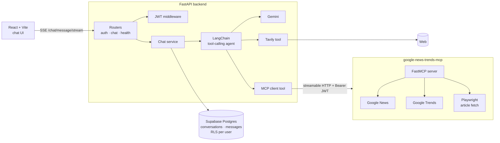

<div align="center">

# mini-chat-agent

**A tool-using AI chat agent that streams its answers, searches the live web, and pulls Google Trends through a self-hosted MCP server.**


</div>

---

## What it does

Ask a question and the agent decides whether it needs a tool. It might search the web with Tavily or pull live trending terms from a self-hosted Google News & Trends **MCP server** (vendored in this repo). Then it streams the answer back token by token. Conversations are stored per user in Supabase, with row-level security.

```
You:    What's trending in the UK right now, and why is the top one in the news?
Agent:  ⚙ google_trends("GB")  ⚙ tavily_web_search("…")
        Here's what's trending in the UK today… (streams in)
```

## Highlights

- **Tool-calling agent:** a LangChain agent on Gemini that calls a tool only when the question needs one. Its iteration limit and timeout are both configurable.
- **Self-hosted MCP server:** `google-news-trends-mcp` is [Jesse Manek's](https://github.com/jmanek/google-news-trends-mcp) open-source FastMCP server (MIT), vendored here and run as its own container. It has five tools (news by keyword, location or topic, top news, trending terms) and Playwright-based article extraction. This repo adds JWT verification in front of it (JWKS or public key, issuer, audience, scope), which is enforced when `MCP_JWT_ISSUER` is set.
- **Streaming over SSE:** `POST /chat/message/stream` emits `chunk`, `tool_start` and `done` events. The UI shows which tool is running while the answer streams in.
- **Graceful degradation:**
  - A tool is registered only when its backend is configured.
  - If the MCP server is down, the agent says so and carries on.
  - With no tools at all, it falls back to a plain chat chain.
- **Model guard:** Gemini 3 models need `thought_signature` on tool calls, which LangChain doesn't support yet. When a Gemini 3 model is configured, the agent automatically uses `gemini-2.5-flash` instead.
- **Auth and data isolation:** Supabase Auth issues JWTs, FastAPI middleware checks them, and Postgres RLS policies mean users only ever see their own conversations.
- **One-command dev stack:** Docker Compose runs the frontend, backend and MCP server, with health checks and start order.

## Architecture



**A single request:**
1. The UI posts the message.
2. The chat service creates or loads the conversation and saves the user turn.
3. The agent runs with the conversation history. Tool calls are streamed as `tool_start` events, and answer tokens as `chunk` events.
4. The final assistant message is saved and returned in the `done` event.

## Tech stack

| Part        | Stack                                                                  |
| ----------- | ---------------------------------------------------------------------- |
| Agent       | LangChain (tool-calling agent + `AgentExecutor`), Gemini 2.5 Flash     |
| Tools       | Tavily search, custom MCP server (FastMCP, `mcp` client)               |
| Backend     | FastAPI, Pydantic Settings, SSE, httpx                                 |
| Data & auth | Supabase Auth + Postgres with RLS                                      |
| Frontend    | React 18, Vite, TypeScript, Tailwind CSS v4, shadcn/ui, React Router 7 |
| Ops         | Docker Compose, container health checks                                |

## Quick start

**You need:** Docker, a [Supabase](https://supabase.com) project, a [Gemini API key](https://aistudio.google.com/apikey), and optionally a [Tavily](https://tavily.com) key.

```bash
git clone https://github.com/AnwarAndargie/mini-chat-agent.git
cd mini-chat-agent

cp .env.example .env
cp backend/.env.example backend/.env
cp frontend/.env.example frontend/.env
cp google-news-trends-mcp/.env.example google-news-trends-mcp/.env
```

1. Fill in the Supabase, Gemini and Tavily values in `backend/.env`.
2. Run `backend/app/services/db/supabase/migrations/001_initial_schema.sql` in the Supabase SQL editor.
3. Start everything:

```bash
docker compose up --build
```

| Service    | URL                                                    |
| ---------- | ------------------------------------------------------ |
| Chat UI    | http://localhost:5173                                  |
| API docs   | http://localhost:8000/docs (Swagger, with Bearer auth) |
| MCP server | http://localhost:9000/mcp                              |

### Run without Docker

```bash
# backend
cd backend && python -m venv .venv && source .venv/bin/activate
pip install -r requirements.txt
uvicorn app.main:app --reload

# frontend
cd frontend && npm install && npm run dev
```

## Configuration

Key settings in `backend/.env`:

| Variable                  | Purpose                                                   |
| ------------------------- | --------------------------------------------------------- |
| `GEMINI_API_KEY`          | Model access                                              |
| `GEMINI_MODEL`            | Defaults to a tool-safe Flash model                       |
| `TAVILY_API_KEY`          | Enables web search (the tool is skipped if unset)         |
| `MCP_URL` / `MCP_TIMEOUT` | Where the news and trends MCP server lives                |
| `MCP_AUTH_HEADER`         | Bearer token sent to the MCP server                       |
| `AGENT_MAX_ITERATIONS`    | Maximum agent steps per turn (default 10)                 |
| `AGENT_TIMEOUT_SECONDS`   | Wall-clock limit per turn (default 60)                    |
| `SUPABASE_*`              | Auth and database                                         |

The MCP server checks every request against `MCP_JWT_ISSUER`, `MCP_JWT_AUDIENCE` and either `MCP_JWT_JWKS_URL` or `MCP_JWT_PUBLIC_KEY`. If verification isn't configured, it rejects every request.

## API

| Method | Route                       | Description                                |
| ------ | --------------------------- | ------------------------------------------ |
| `POST` | `/auth/register` · `/auth/login` | Get a Supabase-issued JWT             |
| `POST` | `/auth/logout` · `GET /auth/me`  | Session management                    |
| `POST` | `/chat/message`             | Send a message, get the full reply         |
| `POST` | `/chat/message/stream`      | Same, streamed as Server-Sent Events       |
| `GET`  | `/chat/conversations`       | List your conversations                    |
| `GET`  | `/chat/conversations/{conversation_id}/messages` | Message history       |
| `GET`  | `/health`                   | Liveness                                   |

## Project structure

```
backend/
  app/
    routers/          auth, chat, health
    middleware/       JWT auth
    services/
      agent/          LangChain agent, tool wiring, model guard
      tools/          Tavily + MCP client tools
      db/             Supabase repositories and SQL migration
frontend/
  src/                React chat UI, SSE client, auth context
google-news-trends-mcp/
  mcp_server.py       FastMCP server and tool registration
  tools.py            news and trends tools, Playwright fetcher
  security/           JWT verification
docker-compose.yml
```

## Credits

- [`google-news-trends-mcp`](https://github.com/jmanek/google-news-trends-mcp) by Jesse Manek (MIT). See `google-news-trends-mcp/LICENSE`.

## Roadmap

- [ ] Eval suite: a golden question set that scores tool choice and answer grounding, run in CI
- [ ] Tracing with Langfuse or LangSmith: per-turn latency, tokens and cost
- [ ] Move the agent to LangGraph for explicit state and retries
- [ ] Cite sources inline in streamed answers
- [ ] Public demo deployment
